<picture>
  <source media="(prefers-color-scheme: dark)" srcset="./assets/adhd-hero-dark.svg">
  
</picture>

  

#### Signal

<picture>
  <source media="(prefers-color-scheme: dark)" srcset="./assets/adhd-signal-dark.svg">
  
</picture>

#### Open tabs

- `TAB 01` **[Leet_Hub](https://github.com/TushantPramanik/Leet_Hub)** · A collection of LeetCode questions to ace the coding interview! - Created using [LeetHub v2](https://github.com/arunbhardwaj/LeetHub-2.0)

- `TAB 02` **[Club_Hub](https://github.com/TushantPramanik/club-hub)** · The All-in-One Smart Campus Operating System! 

<picture>
  <source media="(prefers-color-scheme: dark)" srcset="./assets/adhd-end-dark.svg">
  
</picture>

